# 1. Welcome

MicFX is an app for singers, speakers and home producers. It has two screens, switched at the top of the window:

- **Live mode** is built for performing and practising. Your microphone goes through a chain of effects with a few milliseconds of delay. You can also sing along with a backing track, loop yourself, practise any song with live scoring, and keep a set of songs ready for a show.
- **DAW mode** is a multitrack studio. You record, edit, mix and export tracks, add instruments, and let MicFX help with mixing.

Everything runs **locally**. Nothing you record is uploaded. The only downloads are the stem-splitting model files, once, the first time you use them.

MicFX comes as a **standalone app** and as **AU and VST3 plug-ins** (the Live effects for use inside another DAW, plus eight instruments). Some features, such as DAW mode, setlists and Send to DAW, belong to the standalone app. They are marked *(standalone app)* below.

> **Note.** MicFX is under active development. This manual describes what the app does today. Some features were built and tested with generated test sounds but not yet on every kind of real recording. If a result sounds wrong on your material, every automatic change is an ordinary setting you can adjust or undo.

# 2. First start

## 2.1 What you need

- A Mac (macOS is the main target). Windows and Linux builds work too, with some features, such as AU plug-ins, Core ML and the native Mac menu, specific to macOS.
- A microphone or audio interface, and **headphones**. Without headphones you will get feedback.
- The app itself. Today MicFX is built from its source code: the steps are in the project's README ("Build & run").

## 2.2 Help inside the app

- Point at any control: its name, what it does and its key appear in the **hint line** at the bottom of the window (in both modes), and in a tooltip a moment later.
- **?** lists the keyboard shortcuts of the mode you are in.
- **Help → User manual** (or **F1**) opens this manual. **Help → What's new** lists the latest changes.

## 2.3 First launch

1. Allow **microphone access** when macOS asks.
2. JUCE mutes the input at first to prevent feedback. Click **Settings…** in the yellow bar and untick **Mute audio input**. **Wear headphones.**
3. Open **File → Audio settings…** (or **Options → Audio/MIDI Settings** in the title bar). Pick your microphone or interface and set the buffer size. 128 samples at 48 kHz is about 2.7 ms per buffer. Smaller is quicker but needs more CPU.

The first time, a **welcome card** walks you through three steps: **Audio settings…** and **I'm wearing headphones** (which unmutes the mic), **Mic check** and **Sound check**. **Settings → Help → Show the welcome card** brings it back.

After every rebuild the app's signature changes, so macOS asks for microphone access again.

### The audio status strip and Settings

At the bottom right of both modes a strip shows the audio device, sample rate, buffer, the round-trip latency and the CPU load ("Scarlett 2i2 · 48 kHz · 128 · 5.4 ms round trip · CPU 12 %"). Click it for the audio settings. It turns **amber** for 10 seconds after a dropout (try a larger buffer) and when the input is muted, and **red** when no audio device is open.

**File → Settings…** (**Ctrl+,**) gathers the app's choices in one window: **Audio** (device and buffer advice), **Recording** (the recordings folder, a dry copy of the mic), **Look** (UI size, 80 to 150 %) and **Help**.

The **Options** button in the title bar also has **Save the Live sound to a file…**, **Load a Live sound from a file…** and **Reset the Live sound**. Scenes and setlist songs (3.4, 3.5) are the better way to keep a sound.

## 2.4 Updating

**Help → Check for updates…** (also in the MicFX menu on macOS) shows what is new. **Update and rebuild** downloads the latest version and rebuilds the app, and **Relaunch MicFX** restarts it. The same thing works from a terminal with `scripts/update.sh check` and `scripts/update.sh install`. It will not touch a checkout that has uncommitted changes.

## 2.5 Using the processed mic in Zoom, Discord or OBS

Install a virtual audio device such as BlackHole (`brew install blackhole-2ch`). Set MicFX's output to BlackHole, then pick BlackHole as the microphone in the other app. To hear yourself too, create a Multi-Output Device in *Audio MIDI Setup*.

## 2.6 Using MicFX as a plug-in

The AU and VST3 builds give you the Live effects inside any DAW (the 24 voice presets show up as programs). The eight instruments are separate plug-ins: *MicFX Grand, Nova, Tines, Drawbar, Pluck, Mallets, Beat* and *Kit*. Build them with `cmake --build build/debug --target MicFXInstruments` and copy the `.vst3` or `.component` files from `build/debug/MicFX<Name>_artefacts/` into your plug-in folder. Plug-in builds can also receive MIDI for MIDI learn (VST3; Logic does not pass MIDI to audio effects).

# 3. Live mode

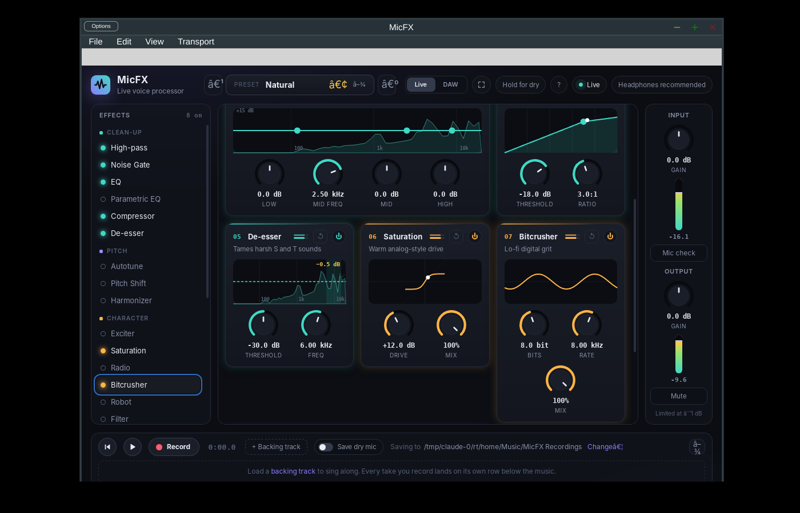

## 3.1 The effect chain

Live mode runs the effects below in one chain. Each can be switched on or off, and every effect has its own **In** and **Out** gain and a **Presets** menu (factory settings plus your own, saved with *Save current as…*).

| Group | Effects |
| --- | --- |
| Clean-up | High-pass, Denoise, Noise Gate, EQ, Parametric EQ, Smooth, Compressor, Opto Compressor, Auto Level, De-esser |
| Pitch | Autotune, Pitch Shift (with formant), Harmonizer |
| Character | Exciter, Saturation, Amp, Radio, Bitcrusher, Robot, Filter, Auto-wah |
| Modulation | Tremolo, Vibrato, Chorus, Flanger, Phaser |
| Space | Doubler, Echo (ping-pong), Cabinet, Reverb, Plate Reverb, IR Reverb, Stereo Width |

The signal path is: mic → input gain → clean-up → pitch → character → modulation → space → output gain → a safety limiter at −1 dB.

The cards move with your voice: the spectrum behind the EQ and filter curves, a dot riding the compressor and gate curves, echo taps replaying what you sang, and level bars for each stage.

### Voice presets

24 presets in five groups: **Clean** (Podcast, Radio Host…), **Tuned** (Pop Tune, Hard Tune, Choir…), **Characters** (Deep Voice, Chipmunk, Demon, Robot, Alien, Ghost, Wah Funk), **Lo-fi** (Telephone, Walkie-Talkie, Megaphone, 8-Bit, Underwater, Tape) and **Space** (Stadium, Cathedral, Astronaut). Click one to load it. **‹ / ›** beside the name (or **Ctrl+← / →**, Cmd on a Mac) step to the previous or next preset, and **1** to **9** load your starred favourites.

### Vocal chains

The preset menu also lists **Vocal chains**: complete vocal sounds by style, each a set of effects in a chosen order with their settings. They are: Pop lead, Pop ballad, Rap lead, Melodic trap, R&B and soul, Rock lead, Indie and lo-fi, Acoustic, Dance top line, Backing vocals, Ad-libs and throws, Podcast, Streamer, and two stage chains (**Live stage: lead** and **Live stage: ballad**) that add no delay. Hover a chain for a one-line description.

Every chain is set up for a voice at about -18 LUFS with peaks near -8 dBFS, and comes out about as loud as it went in, so you can compare chains without the louder one winning. Chains are starting points: change anything, then keep the result with *Save this sound as…*.

**Macros.** Every vocal chain comes with the same eight macro knobs: **Tune**, **Body**, **Presence**, **Squeeze**, **De-ess**, **Drive**, **Delay** and **Reverb**. Each turns what that chain has (Squeeze the compressor's threshold and the opto's amount, Reverb the plate's mix, and so on) and starts where the chain's own settings are, so loading a chain sounds as designed. As the names are the same in every chain, a MIDI controller or pedal mapped to them keeps working when you switch chains. A knob with nothing to turn in a chain (Tune in the Rap lead, which has no autotune) does nothing there.

**Fit the chain to your voice.** A chain's compressors and gate expect that -18 LUFS. To make a chain fit your mic and room, load it, open **Sound check** and press **Keep this sound, fit the levels**, then sing for 10 to 20 seconds with a few pauses. The chain's effects and their settings stay as they are; only the input gain (so your voice arrives at -18 LUFS), the gate's threshold (from the room between your phrases), a Classic de-esser's threshold and the denoiser's picture of the room are set. Before / After and Revert work as in the full sound check.

In the DAW, the vocal chains are in the library sidebar (**Presets → Vocal chains**) and in every track's chain menu, along with five made for the DAW: **Vocal bus: glue** for a group of vocal tracks, **Vocal plate return** and **Vocal delay return** for return tracks, and two rack versions: **Pop lead: parallel squash** (a clean chain with a hard-squashed one blended under it) and **Rap lead: dry + wet space** (the voice dry, with its slap and booth on a parallel chain whose level you set on the rack). After a vocal chain loads onto a track with audio, a toast offers **Fit to this track**, also in the chain menu at any time: it listens to the track's clips and sets the chain's input gain, gates and Classic de-essers the same way, as one undo step.

### Vocal dynamics and space

- **Compressor**: **Clean** (the original), **Punch** (grabs peaks fast, a touch of colour) or **Glue** (slow and even). **Knee** softens the onset, **Mix** below 100 % is parallel compression, **Auto makeup** brings the level back. The picture shows the gain reduction.
- **Opto Compressor**: a slow, smooth leveller for after the Compressor ("a fast one for peaks, then a slow one for level"). Turn up **Amount** until it takes off about 3 dB, then set **Output**.
- **Noise Gate**: **Range** turns down instead of muting (8-12 dB is a gentle expander for speech and stage mics), **Hold** and **Release** stop word endings being cut, **Focus** ignores kick drum and cymbal bleed.
- **De-esser**: **Smart** mode judges the S against the rest of your voice, so it cuts the same whether you whisper or belt. **Range** limits the cut, **Wide** dips the whole voice (natural on dark voices), **Listen** plays only what is taken out.
- **Saturation**: **Tape**, **Tube** and **Clip** keep your level steady as you turn up Drive; **Tone** tilts brighter or darker.
- **Doubler**: **Micro shift** detunes two copies a few cents and stays clean in mono; **Double track** sounds like a second take.
- **Echo**: **Sync** follows the tempo (in Live: the **Tap** button, else the host or the looper; in the DAW: the song's tempo). **Duck** lowers the repeats while you sing; **Low cut** and **High cut** shape them.
- **Plate Reverb**: the classic vocal reverb. **Pre-delay** keeps the words clear, **Duck** lets the reverb bloom in the gaps.

### Autotune

- A pitch detector tracks your voice every 5 ms. The nearest note of the chosen **key and scale** becomes the target. Scales: chromatic, major, minor, harmonic minor, pentatonics and blues.
- **Speed** at 0 ms gives the robotic "hard tune" sound. 20 to 60 ms sounds natural.
- **Amount** below 100 % only partly corrects the pitch.
- **Match song** (Live mode) listens to the loaded backing track and sets the key and scale for you.
- Latency is roughly half a pitch period (1 to 5 ms) and only while Autotune or Pitch Shift is on.

Chromatic works for any song. Pick the song's key and scale for a tighter, more musical result.

### Harmonizer

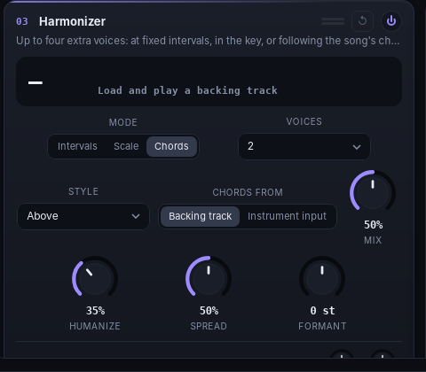

Up to four extra voices, picked in one of three ways (**Mode**):

- **Intervals**: a fixed number of semitones from your voice (+4 is a major third).
- **Scale**: steps of the Autotune key and scale, so a "third" is major or minor as the key needs.
- **Chords**: notes of the chord that is playing now. **Style** puts the voices above you, below you, alternating, or the chord's bass note under you with the others above.

**Chords from** decides where the chords come from:

- **Backing track**: MicFX works out the chords of the track you loaded and changes voices exactly when the song does.
- **Instrument input**: a guitar or keyboard on input 2 of your interface (it takes 0.1 to 0.3 s to settle on a new chord).
- **MIDI keys**: the chord you hold on a MIDI keyboard. One key alone plays that key's triad. Held keys win over the other sources.

**Humanize** gives every voice a small delay and pitch drift so they sound like separate singers. **Spread** places them across the stereo field. **Formant** makes the voices sound bigger or smaller than you.

### Denoise

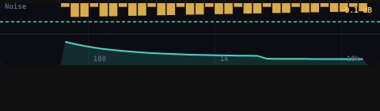

A spectral noise reducer. Unlike the gate, which only mutes the gaps between words, Denoise removes steady noise (hiss, hum, fans, air conditioning) from every frequency band, even while you sing.

- **Adaptive** (on by default) keeps following the room without learning your voice as noise.
- **Learn noise**: switch it on during a few seconds of room noise only, then off. That profile is kept.
- **Reduction** is the most it turns noise down: 8 to 12 dB is natural, 25 dB or more is aggressive. **Threshold** treats more or less of the signal as noise.
- The card shows the noise profile and how much each band is being turned down.
- It adds one FFT frame of latency (about 11 ms), only while on, and MicFX reports this to the host.

### Parametric EQ

A seven-band EQ for mixing: low cut and high cut (24 dB per octave), a low shelf, three bells and a high shelf, ±18 dB. Drag the points on the curve for frequency and gain, scroll on a bell to change its width. Every band also has knobs.

### Smooth (resonance suppressor)

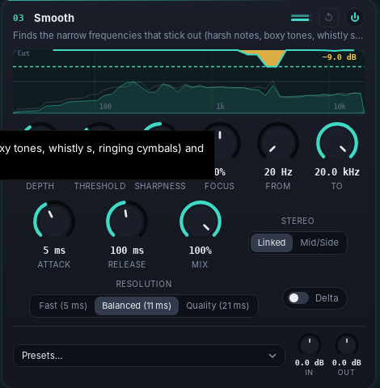

Finds frequencies that ring or sound harsh and turns them down automatically, only when they stick out. It is the standard cure for a harsh vocal. Resolution is **fast**, **balanced** (default) or **quality**; higher quality costs a little more latency. Smooth does not touch the lowest few hundred Hz, so it leaves the body of your voice alone.

### Auto Level

Rides your level like an engineer on a fader. In Live mode it holds a **steady loudness**, or stays **a few LU over the backing track** so you can always hear yourself.

### Amp and Cabinet

- **Amp**: a built-in guitar and bass amp with four models (Clean, Crunch, Lead, Bass), tone stack, presence and master.
- **Cabinet**: speaker cabinets (1×12 open, 2×12, 4×12, 4×10 bass, 1×8), with microphone position (centre, off-axis, edge). Choose *Your IR file* to load your own impulse response.
- **IR Reverb**: five rooms made by MicFX, or your own impulse response file up to 20 seconds, with pre-delay and cuts.

The effect file (IR) belongs to the card and is not saved inside scenes or presets.

### Sound check

Press **Sound check** under the input meter. Choose a style and a length (10, 15 or 20 s), press **Start** and sing. MicFX sets the chain for your voice, microphone and room, shows **what changed and why**, and gives advice on the input gain. You can switch **Before / After**, **Revert**, **Save as scene**, or **Keep** the result.

### Undo

Every change to the Live sound is an undo step: a knob turn (one step once your hand stops), a preset, a card reset, Mic check and a kept Sound check. Use the **↶ ↷** buttons on the preset bar, **Ctrl+Z**, and **Ctrl+Shift+Z** or **Ctrl+Y**. The tooltip says what will be undone ("Undo: Load preset Pop Tune"). Presets now move with **Ctrl+← / →** so the arrows alone never swap your sound.

## 3.2 Sing along and record

The panel at the bottom of the window is a small multi-track player.

1. **+ Backing track** loads a song (WAV, AIFF, FLAC, Ogg or MP3, plus M4A on macOS). It appears as the first row with its waveform.
2. Press **Record** (or **R**). The music plays and you hear it mixed with your processed voice.
3. Press **Stop**. Your recording lands on a new row at the point where you started. Record again for more takes. Earlier takes play back while you record.

- **Space** plays and pauses. Click a row to move the playhead.
- Each row has **M** (mute), a volume slider (double-click for 0 dB) and **×** (remove from the session; the file stays on disk).
- Takes contain only your voice, never the backing track. They are shifted earlier by your interface's round-trip latency so they line up with what you heard.
- Takes are 24-bit WAV files in `~/Music/MicFX Recordings`. **Change…** picks another folder. **Save dry mic** also writes your unprocessed voice to a second, aligned file so you can reprocess it later.
- The list is kept: it comes back after switching to the DAW and back, and after a restart.
- **Open in DAW** puts the backing track and every recording on their own DAW tracks, at the same places and levels, to edit and mix them there.

### Capture: never lose a take

Live mode always keeps the last few minutes of your voice (processed and raw) in memory. If you forgot to press Record, press **Capture** in the transport bar and choose the newest 30 s, 1 min, 3 min or everything. It becomes a take on a new row (aligned to the backing track if it was playing). **Keep** sets how much is kept (1 to 5 minutes, or off), about 35 MB per minute per channel. It stays in memory and is never written to disk until you capture.

In DAW mode the **Capture** button does the same for the armed audio tracks (right-click for how much). MIDI input is not captured yet.

## 3.3 Looper

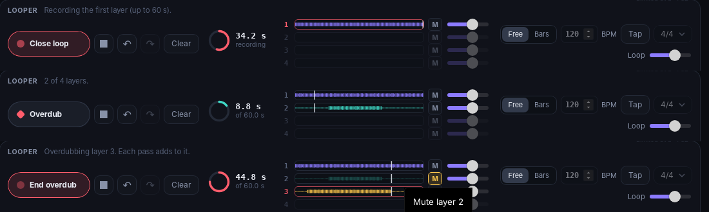

**Looper** in the top bar opens the looper. It stacks up to four layers of your processed voice and plays them under what you sing.

1. Press **Record loop** (or **L**) and sing. Press it again to close the loop. It plays at once.
2. Press **Overdub** (L) to sing another layer on top, **End overdub** (L) to stop.
3. **↶ / ↷** (U / Shift+U) undo and redo the top layer. **■** (K) stops and **▶** plays from the top. **Clear** needs a second click.

- **Free** loops are exactly as long as you recorded (¼ s to 60 s). **Bars** rounds the first layer to whole bars at a tempo you type or **Tap**.
- Each layer has a waveform, **M** and a level slider. **Loop** sets the volume of all layers.
- **Save WAV** writes each layer to the recordings folder. **Send to DAW** *(standalone app)* puts each layer on its own DAW track ("Loop 1" and on), repeated as often as the **×** menu says. In Bars mode the project takes the loop's tempo and time signature.
- The loop is part of what **Record** captures. The loop itself is not saved when you quit.

## 3.4 Scenes

The bar above the effects keeps up to eight **scenes**: the sound of each part of a song (verse, chorus, bridge). A scene holds every setting except the input gain.

- **+ Scene** saves the current sound. Click a scene (or **[** and **]**) to go there. Knobs glide over the **Glide** time.
- After you change the sound, the active scene shows a dot. **Save to …** puts the changes into it. Double-click to rename, right-click to save into it or delete it.

## 3.5 Setlists *(standalone app)*

**Setlist** in the top bar opens the show's songs in order. Each song keeps its sound, scenes, looper tempo, key, backing track, lyrics and notes.

- Set up a song, then **+ Add the current sound as a song**. **Save the sound to this song** updates it later.
- Click a song to load it: sound, scenes, tempo, autotune key and backing track all change.
- **Page Down / Page Up** (page-turner pedals) go to the next and previous song.
- **Stage view** shows the song's name, key, tempo, notes and **lyrics in large type**. Lyrics in `.lrc` form (`[01:02.50] words`) follow the backing track line by line.
- Setlists are saved as `.micfxset` files; the last few are under **Recent**.

## 3.6 MIDI learn

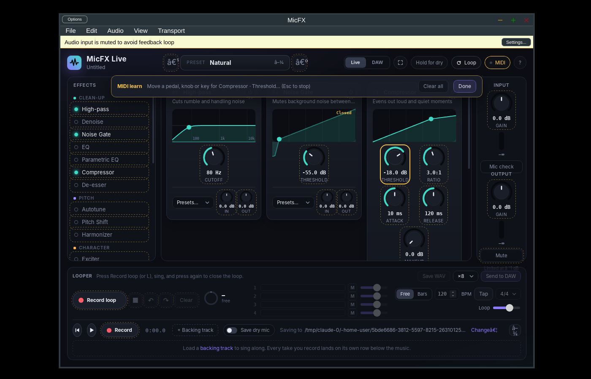

Pedals, knobs, pads and keys on any MIDI controller can drive the Live screen. In the app every MIDI input is open.

1. Press **MIDI** in the top bar. Everything you can map is outlined.
2. Click a knob, switch, effect, choice or button, then move a knob, press a pedal or key, or send a program change.
3. Map more, or press **Done** (or Esc). Right-click a mapped control, or use **×** in the list, to unmap it.

A knob (CC) moves a value and "picks up" so the sound never jumps. A pedal, pad or key flips a switch or steps through a choice. You can map the looper's buttons, previous and next preset, each scene and previous and next scene, previous and next song, Mute and Record. Mappings belong to the app (`MIDI mappings.json`), not to presets.

**In DAW mode** the same **MIDI** chip maps the DAW's play, stop, record, loop range, Punch, click, undo and redo, and the **selected track's** volume and pan (click the selected track's volume or pan slider while learning). Mapped keys and pads drive the DAW and don't play the instrument; Live mappings stay quiet while you are in the DAW.

## 3.7 Practice any song

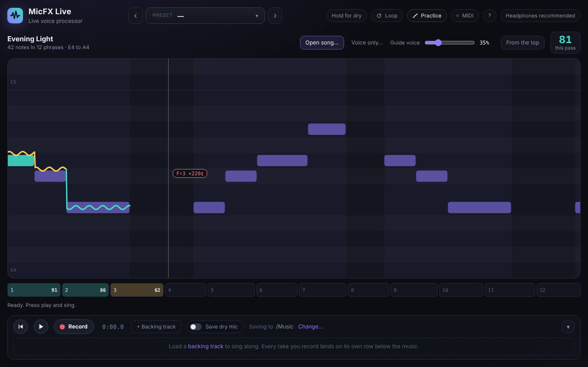

**Practice** in the top bar swaps the effect rack for a practice lane.

1. **Open song…** takes any song. MicFX splits it into stems, keeps the original voice as a quiet **guide**, and finds its melody note by note, in phrases. The rest becomes the backing. **Voice only…** takes a recording of a voice on its own (no splitting).
2. Press play and sing. The target notes scroll past the playhead and your pitch draws over them: **green** within 25 cents, **amber** within 60. Sing in any octave.
3. Each note is scored as it ends for pitch, timing and steadiness. Each phrase gets a score in the strip, and the pass gets a score at the top right. Hover a phrase to see whether you leaned sharp or flat, early or late.

- **Guide voice** sets how loud the original singer plays under you. Click a phrase to go back and sing it again. **From the top** restarts.
- A song is prepared only once (kept in `Application Support/MicFX/Practice`), so opening it again is instant.
- Timing is measured against what you hear: your interface's latency is removed.

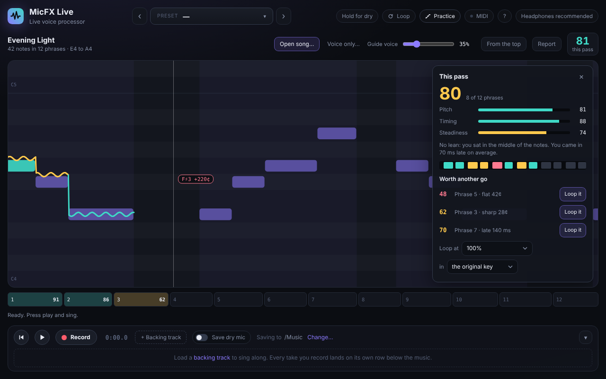

When the song stops, the **report** opens (or press **Report**): the pass score, pitch, timing, steadiness, whether you lean sharp or flat, a heat map of every phrase, and up to three weak phrases worth another go. **Repeat phrase** plays a weak phrase over and over with a short lead-in. Pick a **speed** (down to 50 %) and a **key** (up to 5 semitones either way) and the backing and guide are re-rendered to match. **Next weak phrase** moves on, **Back to the song** returns.

If the song's sections have been found (see the Song map in section 4.13), a strip of sections appears and you can loop one.

# 4. DAW mode *(standalone app)*

Switch **Live / DAW** at the top of the window.

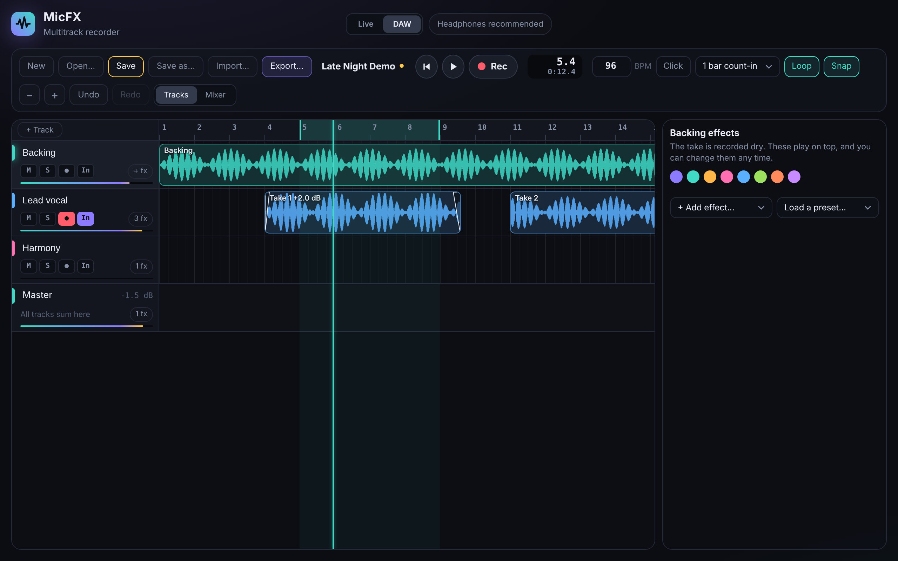

## 4.1 Tracks and clips

- **Tracks** hold **clips** on a timeline with a bar ruler. Each track has volume, pan, **M** (mute, or the **M** key), **S** (solo), **●** (arm for recording) and **Mon** (monitor: hear the mic through the track's effects while you play; click for Mon, Auto or Off).
- Add tracks with **Ctrl+T** (audio) or **+ MIDI** (**Ctrl+Shift+T**). Rename with **Ctrl+R**. **Ctrl+Delete** removes a track.
- **Group** tracks (**Ctrl+G**, select several with Shift+click) into a foldable header with one fader. A group can carry effects and sends for all its tracks. **Ctrl+Shift+G** ungroups.
- Select several clips or tracks with Shift or Ctrl+click, or by dragging a box on an empty lane.
- **Ctrl on a Mac is Cmd.** Press **?** for the full list of shortcuts.

### Recording

**Recording is always dry.** Arm one or more tracks and press **Rec** (or **R**). The take is the unprocessed mic and the track's effects play on top, so you can change them afterwards. A click and count-in are optional. The take is shifted by the audio round-trip latency.

- **Inputs and stereo tracks.** The app opens every input of your interface (up to 16). Each audio track picks what it records: one input (mono), a neighbouring pair, or any two inputs as left and right. Tracks on different inputs record at the same time, each into its own WAV.
- **Loop recording**: set a loop range on the ruler (**L** toggles it), start recording inside it, and every pass becomes a **take** (see 4.7).
- **Punch in and out**: turn on **Punch** next to the loop button (**Shift+R**). The loop range turns red. Press Record anywhere: playback starts a **pre-roll** before the range (1 bar by default, with the music and the click), only the range is recorded, and it stops at the end of the range. The take lands in take lanes so you can comp it. Set the pre-roll in the click's popover (the arrow next to the click button).
- **Click only while recording** (also in the click's popover) keeps the metronome quiet while you just listen.

### Editing clips

- Drag clips to move them (also to another track). Drag edges to trim and the top corners to fade.
- **Ctrl+E** splits at the playhead, **Ctrl+D** duplicates, **Delete** removes, **Ctrl+X / C / V** cut, copy and paste.
- **Snap and grid**: edits snap to the grid next to the magnet button: **Adaptive** (follows the zoom), Bar, 1/2 to 1/32, and triplets. **Ctrl+1 / Ctrl+2** make it finer or coarser, **Ctrl+3** switches triplets, **Ctrl+4** turns snap on and off. Clips also snap to other clips' edges, markers, the playhead and the loop range. Hold **Alt** to drag freely.
- Tools: **V** (or **1**) Select, **2** Range, **B** Cut (click a clip to split it there), **G** Gain (drag a clip up or down).
- **Range tool**: drag across one or more tracks to mark a stretch of time (Shift+click moves an end). Then **Delete** clears what's inside, **Ctrl+Shift+Delete** deletes the time (the rest of the song moves left), **Ctrl+E** splits at both ends, **Ctrl+D** duplicates it after itself, **Ctrl+L** loops it, and right-click has **Insert silence** and more. **Esc** clears it.
- **Crossfade**: right-click the first of two clips that touch, **Crossfade with the next clip**.
- **Reorder tracks** by dragging a track header up or down.
- **Bounce to a new track** (track menu or **Ctrl+B**): renders the track through its effects or instrument to audio on a new track under it and mutes the original. With a range marked, only that range. It frees the CPU a heavy plug-in uses.
- **Ctrl+Z / Ctrl+Shift+Z** undo and redo every edit. **Right-click the undo button** for the last 30 steps and go back to any of them.
- Drag on the ruler to mark a loop, **K** adds a marker, **[ / ]** jump between markers, **Shift+1 … 9** go to the first nine markers, **T** taps the tempo. Right-click a marker for **Loop to the next marker**.
- **Missing audio files** (moved or deleted outside MicFX): the banner's **Locate…** asks for the folder they are in now and finds each one by name, in subfolders too. A missing clip's menu has **Locate the missing file…**.
- The **↔** and **↕** sliders (or Ctrl+scroll and Alt+scroll) zoom time and track height. **Follow** keeps the playhead in view while playing.

## 4.2 The bottom panel

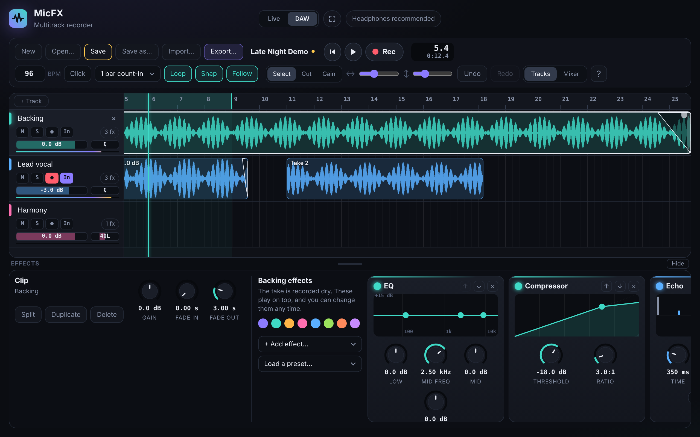

The panel under the tracks has tabs: **Effects**, **Clip**, **Mixer** and **Patterns**. Drag the bar above it to resize, or press **E** to fold it away.

- **Effects** shows the selected track's inserts left to right in chain order.
- **Clip** shows the selected clip (gain, fades, split, loop, strip silence), **Pitch & time** (transpose, quantize, tempo) and, for a MIDI clip, the piano roll.
- **Mixer** and **Patterns** are described below.

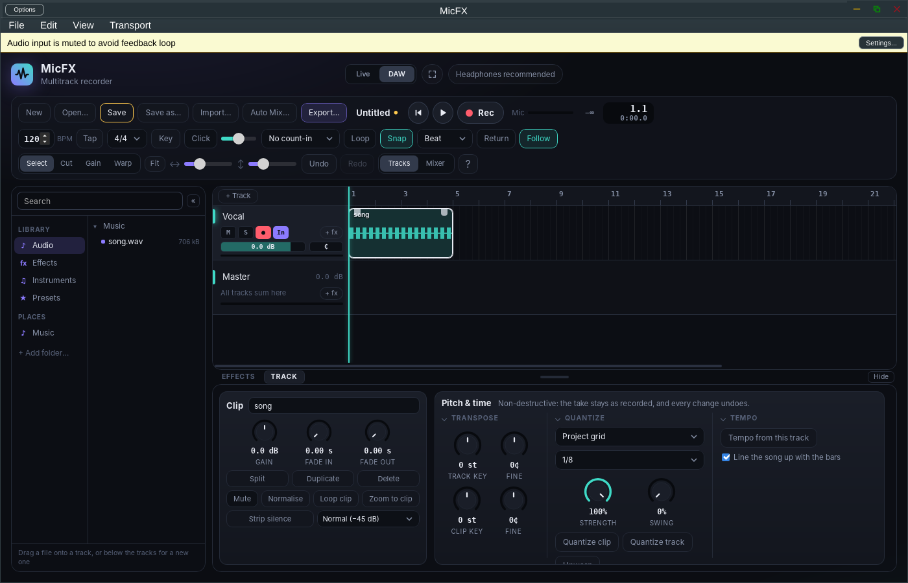

## 4.3 The library

The library on the left lists audio files (this project, Recordings, Music, Downloads, Desktop and any folder you add with **+ Add folder…**), effects, instruments and presets.

- Drag a file onto a track to put a clip where you drop it, or below the tracks for a new track. Drag an effect or preset onto a track, the master, a mixer strip or the effects panel.
- Double-click (or Enter) adds to the selected track.
- **Ctrl+F** searches everything. **Shift+B** folds the library to a thin strip. Favourites and recent items are at the top. Files can be previewed before you use them.

## 4.4 Effects, inserts and presets

Each track (and the master) has its own **inserts**: any Live effect, in any order, or a preset loaded into the track. Each chain has its own **In** and **Out** gain with meters. The effect cards animate just as they do in Live mode, and every effect has the same Presets menu, shared between Live and DAW.

### Third-party effect plug-ins

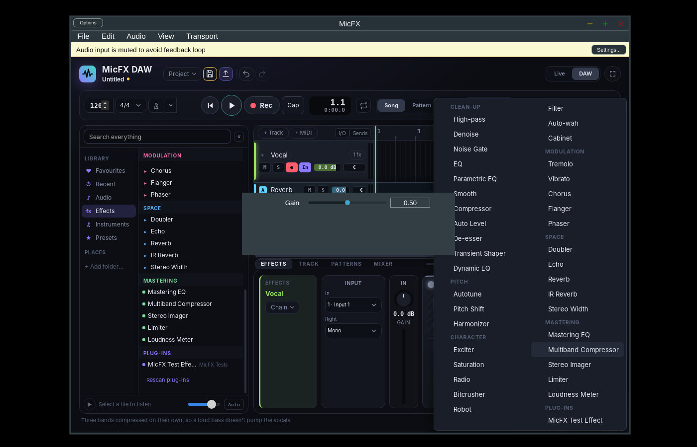

MicFX can host **VST3** effects (and **AU** on macOS) as inserts. Use **Add effect → Plug-ins**, or drag one from the library's plug-in list. **Rescan plug-ins** in the library finds newly installed ones. The plug-in opens in its own window, its settings are saved in the project, and MicFX reports its latency so the tracks stay in time. Auto Mix leaves plug-in inserts alone.

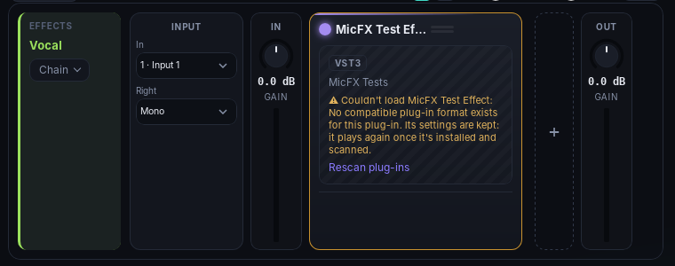

If a plug-in is missing when you open a project, the insert stays in place marked as missing and loads again after a rescan finds it.

## 4.5 The mixer, returns and master

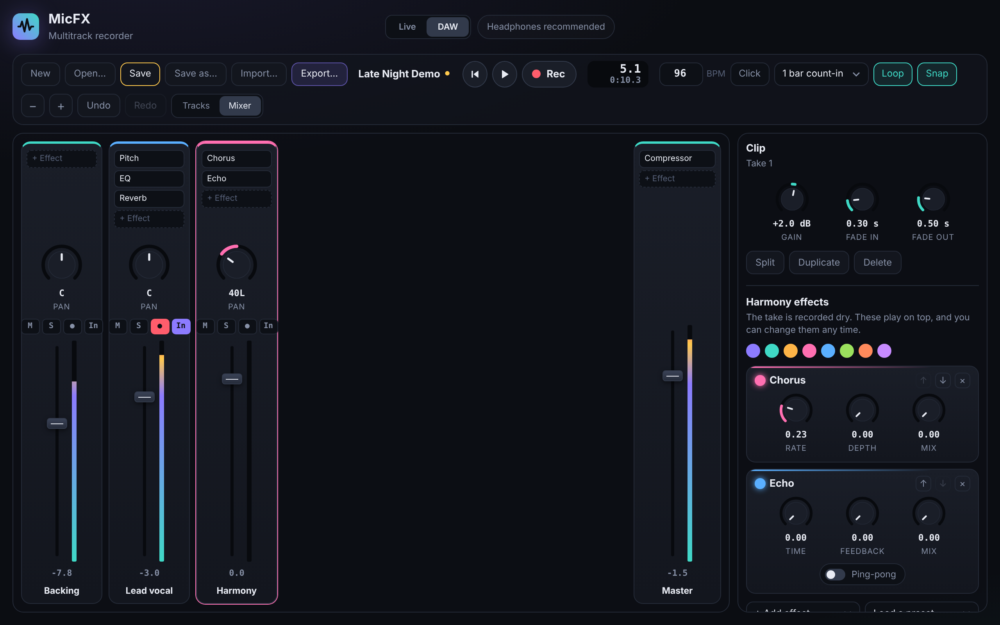

- The **Mixer** tab of the bottom panel (Tab or X jumps to it) shows a strip per track, the return tracks and the master. Each strip has input choice, left/right meters, sends, volume, pan, M/S and an output picker.
- **Return tracks** hold shared effects. A new project starts with a **Reverb** (A) and a **Chorus** (B) return, fully wet. Each track has a **send** knob per return (post-fader, or **Pre** in the Effects panel). **+ Return…** adds Echo, Doubler, Flanger, Phaser or an empty return.
- An **output picker** on a track can send the whole track into a return instead of the master, which makes a group bus.
- The **master** bus has its own inserts, volume and balance. Returns and master scroll along with the tracks.

### Mastering effects

Under *Mastering* in Add effect and the library (DAW only): **Mastering EQ**, **Multiband Compressor** (three bands), **Stereo Imager** (width with mono bass and a correlation readout), **Limiter** (look-ahead brickwall) and a **Loudness Meter** (momentary, short-term and integrated LUFS against a target). Put them on the master.

### Automation lanes

Automation makes a setting move over time: the voice comes up in the chorus, the echo opens on the last word, the guitar pans across.

- Click the **curve button** in a track's header (or **Show automation lanes** in the track's right-click menu) to unfold its lanes. A dot on the button means the track has automation.
- Each lane moves one thing, picked in the menu at its left: **Volume** (a ride in dB on top of the fader), **Pan**, a **send** to a return, any **effect value** on the track (racks included) or one of the track's **macros** (every value mapped to the macro follows; a value's own lane wins).
- **Click** in a lane to add a point; it snaps to the grid (hold **Alt** for free placement). **Drag a point** to move it, together with any other selected points (hold **Shift** while dragging to move only up and down). **Drag across empty space** to select the points in that range, **Shift+click** a point to add it to the selection, and press **Delete** to remove them. **Double-click** or **right-click** a point to delete it.
- **Ctrl+drag**, or drag with the **Draw tool** (P), to draw a curve freehand over what was there. Straight stretches are kept as few points.
- **+** adds a lane under the current one, **⌫** clears a lane, **×** hides it (its points still play). **Clear all automation** in the track menu empties every lane of the track.
- Each gesture is one undo step. Automation plays while the song plays and in exports; when you stop, pan, sends, effect values and macros go back to their knobs.
- **Write automation** by moving knobs while the song plays: the automation button next to Loop and Punch cycles **Off → Touch → Latch**. In **Touch**, moving a track's volume, pan, a send, an effect value or a macro writes its lane while you move it; let go and the lane carries on as it was. In **Latch**, the last value keeps writing until you stop. While you write, you hear the knob; when the pass ends the knob goes back to where it was, the moves are thinned to a few points, and each pass is one undo step. A volume move adds to the ride already there.
- **Thin points** (right-click a lane) keeps the same curve with fewer points.
- **Automation follows clips** (right-click a lane; on by default): moving a clip takes the automation under it along, and duplicating, Ctrl+dragging, copying and pasting a clip brings a copy. Effect lanes stay on their own track.

## 4.6 Projects and export

- A **project** is a folder (`My Song.micfx/`) with `project.xml`, the audio, autosave backups and exports. It moves and backs up as one thing. After a crash you are offered the newest autosave.
- **File** menu: new, open, save (**Ctrl+S**, Shift for Save As), import audio (**Ctrl+I**), export, audio settings.
- **Export** (**Ctrl+Shift+R**) renders the mix, or one stem per track, to 16, 24 or 32-bit WAV, faster than real time, optionally normalised or limited to the loop range. Instruments are included.
- The standalone app has File, Edit, Audio, View, Transport and Help menus in the macOS menu bar (or under the title bar on Windows and Linux). **Full screen** is the ⛶ button, **View → Full screen**, **F11**, or **Ctrl+Cmd+F** on a Mac.

## 4.7 Takes and comping

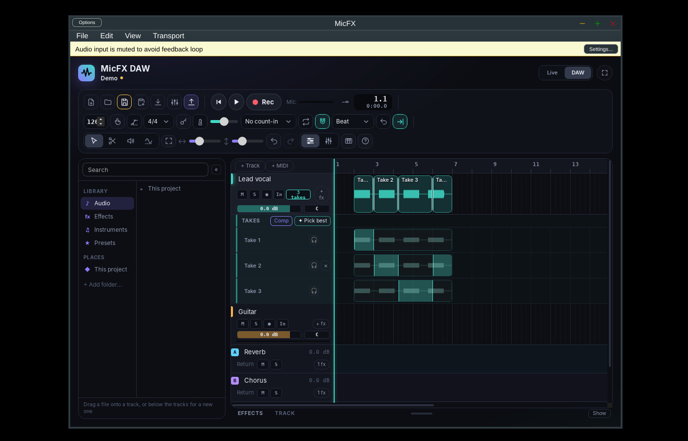

When you record over existing audio, or with a loop, every pass becomes a **take** shown in lanes under the track. The track's main lane is the **comp**: the pieces of different takes you chose.

- Click or drag on a take lane to put that part into the comp (short crossfades make the joins clean). Audition a take on its own.
- **Auto Comp** (in the Auto Mix panel, *Pick the best takes*) cuts takes into phrases, scores each for pitch, missing lines, clipping and level, and picks the best pieces for you. You can then change any piece by hand.
- Take lanes can be shown, hidden, renamed and removed from the track menu.

## 4.8 The clip editor: pitch and timing

Double-click an audio clip (or press **W**) to open the **clip editor** on the Clip tab. It has two views, **Wave** and **Notes**.

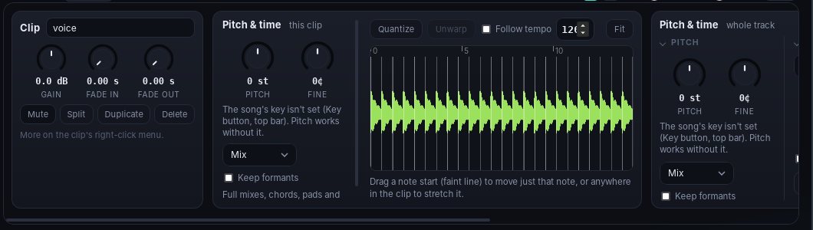

**Wave view** is laid out like a sample editor: a toolbar (Wave / Notes, **♩ Musical** and the clip's tempo, the algorithm, **Compare** Pitch / Time, Solo, Loop, Fit), an overview of the whole recording (drag the box to scroll, its edges to zoom), a ruler in the project's bars and beats (click to move the playhead, drag to mark a loop range) and the waveform. On the left, one section per job; **the open section is the tool**. With no tool open (or Pitch), the pointer only moves the playhead, scrolls and zooms, so nothing changes by accident. Keys **1 / 2 / 3 / 4** open Warp, Hitpoints, Tempo and Quantize; **Esc** closes it.

- **Pitch**: the clip's transpose (semitones and cents) and the algorithm.
- **Warp** (1): click pins a **warp tab** where the audio plays now; drag a tab to move that moment of the audio, which stretches between the tabs either side (the number by each tab is the stretch of the audio before it). Drag a tab's handle in the ruler to slide it along the audio. **Alt-click** or double-click removes a tab, box-select in the ruler, **← / →** nudge. **Tabs at hitpoints** pins every note start. **Hold neighbours** (or Ctrl/Cmd at the press) pins the note starts either side so only one note moves. **Compare Time** plays the clip without its tabs.
- **Hitpoints** (2): the note starts found in the audio, which Quantize, the Warp tool and every Create button use. **Threshold**, **Min length** and **Beats** choose which count. Click between two to hear that slice (**Tab** for the next), click one to lock it, **Shift-click** to disable it, **Alt-click** to add one, drag to move one. **Create**: split the clip at them, song markers, a **groove** (Quantize can use it on other tracks), warp tabs, or MIDI drum notes.
- **Tempo** (3): the clip's own beats, drawn in orange. **Detect: steady** finds one tempo and the downbeat, **Detect: follow** follows a take that speeds up and slows down, **÷2 / ×2**, **From the project** (the take was played to the click), typed BPM or length in bars. Drag the first bar line to move the downbeat, another line to change the tempo, **Ctrl/Cmd-drag** to pin one beat. With **♩ Musical** on, those beats play on the project's grid, so a drifting take comes out straight and follows tempo changes. **Project tempo from this clip** sets the song's tempo from it.
- **Quantize** (4): note value with straight, triplet or dotted feel, or a groove (another track's, or one saved from hitpoints); Strength, Swing, Catch, Safe zone (notes already this close stay), Max move, Iterative, Slice, and **Auto** (changing a setting quantizes again). The same controls are in the track's Pitch & time card.
- **Several clips at once**: select clips on several tracks and open the editor: each is a lane. Click a lane's name to make it the active clip. With **Edit: All clips**, one click or drag warps every clip at that moment, in one undo step. **Copy tabs / Paste tabs** put one clip's tabs on others.
- You **hear your drags while playing**, and only the part you changed is re-rendered. Ctrl+scroll zooms. "Rendering…" shows while a change is being prepared.

In the arrangement: the **Warp tool** (**J**) works on the selected clips (click a clip first). Press pins a tab and drag moves that moment. **Ctrl/Cmd + drag a clip's edge** stretches the clip (0.25x to 4x) instead of trimming it. **Alt+N / Alt+B** move the playhead to the selected clip's next or previous hitpoint. The clip menu has **Split at hitpoints**, **Stretch to project tempo**, **Copy / Paste warp tabs** and **Make warp permanent**, which writes what the clip plays to a new audio file (the original stays, and undo puts it back).

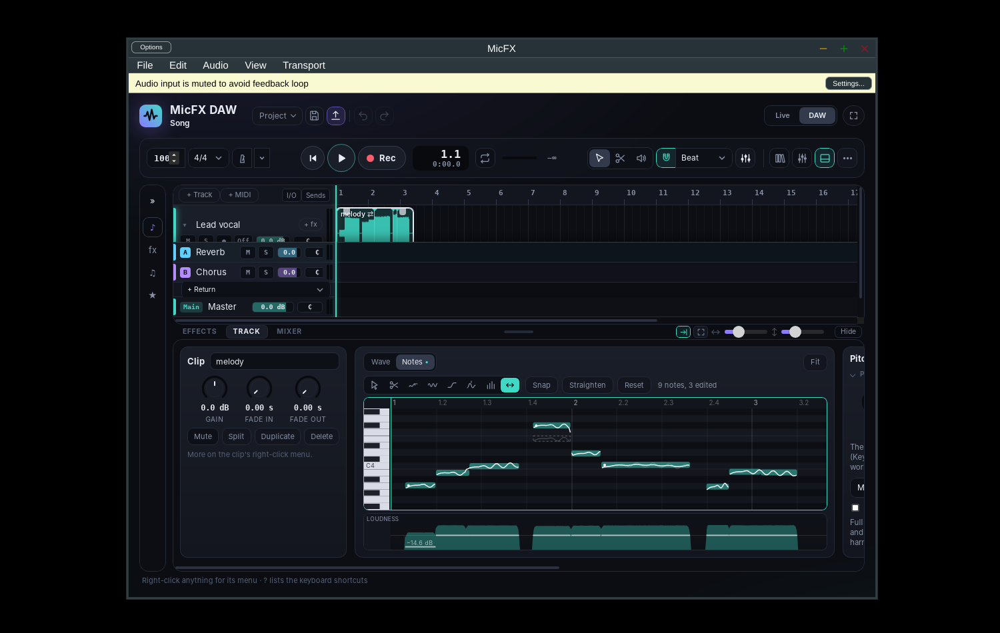

**Notes view** is a note-by-note vocal editor. Your sung notes appear as blocks on a keyboard with the pitch curve, with the energy of your voice in a lane below.

- Tools (keys): **V** select, **C** cut, **D** drift, **M** modulation (vibrato), **T** transition, **F** formant, **L** loudness, **W** timing.
- Move a note to retune it, **Snap** pulls notes to the nearest scale note, **Straighten** reduces drift, **Reset** puts things back. You can also change a note's formant and level.
- Each note edit is non-destructive and you hear the result when you play.

## 4.9 MIDI tracks, instruments and the piano roll

- **+ MIDI** adds a MIDI track with a built-in synth. Drop another instrument from the library on a track to use it. **VST3** instruments (and **AU** on macOS) are found by a scan of the usual folders (**Rescan plug-ins**). Open-source ones like Surge XT, Dexed, Vital or OB-Xd work, and so do commercial ones like Kontakt, which opens in its own window from the ♫ button on the track. Their settings are saved in the project.
- **Arm** a MIDI track to play it from your MIDI keyboard (every MIDI input is open) and record. The take becomes a MIDI clip, and the sustain pedal is kept.
- **Computer keyboard piano**: press **Ctrl+K** (or the toolbar piano button) to turn the computer keyboard into a MIDI keyboard. **A S D F G H J K** are the white keys and **W E T Y U O P** the black keys. **Z / X** change octave and **C / V** change velocity. While it is on, single-letter shortcuts are off; Space, Shift+letter and Ctrl shortcuts still work. **Esc** or **Ctrl+K** closes it.
- Double-click a MIDI track's lane for an empty clip, then edit its notes in the **piano roll** on the Clip tab: click to add, drag to move, drag the end to resize, double-click to delete, box-select, **↑ / ↓** to transpose, **Q** to quantize to the grid, **Ctrl+C / X / V** to copy, cut and paste notes at the playhead. When the song has a key (4.17), its notes' rows are tinted and the root a little more.

### The MicFX instruments

Each instrument has a window of its own (presets, knobs, a scope, and a clickable keyboard), opened from its button on the track.

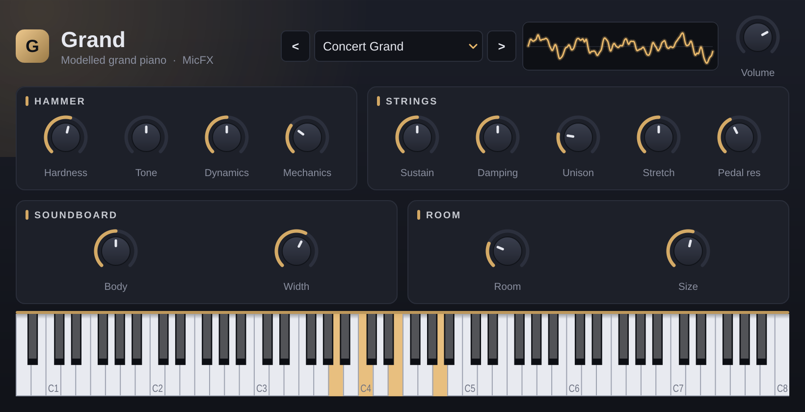

| Instrument | What it is |
| --- | --- |
| **Grand** | A modelled grand piano: hammer hardness and tone, string beating, dampers and sustain pedal, soundboard and room. Presets: Concert Grand, Bright Pop, Felt Piano, Upright, Honky-Tonk, Ballad Hall. |
| **Nova** | An analog-style polysynth: two oscillators with unison, sub and noise, resonant filter with envelope, LFO, glide, chorus, echo and room. Presets for pads, strings, basses, leads, brass and plucks. |
| **Tines** | An electric piano with tine or reed, bark that grows with playing strength, tremolo, chorus and room. |
| **Drawbar** | A tonewheel organ: nine drawbars, percussion, key click, vibrato and chorus, overdriven amp, and a rotary speaker (the mod wheel switches it to fast). |
| **Pluck** | Plucked strings: nylon and steel guitar, harp and koto bodies, pick hardness and position, palm mute. |
| **Mallets** | Struck bars and bells: marimba, vibraphone with motor tremolo, glockenspiel, kalimba, tubular bells. |
| **Beat** | A synthesized drum kit on General MIDI drum notes (36 kick, 38 snare, 42/46 hats, toms, crash, ride, clap, cowbell…), with tuning and decay per drum. |
| **Kit** | A sampler drum kit with sixteen pads on notes 36 to 51. Drop audio files on the pads or use *Load samples…*. Each pad has level, pan, tune, decay and a choke group. The kit starts empty and no samples ship with it. |

## 4.10 Pattern looper

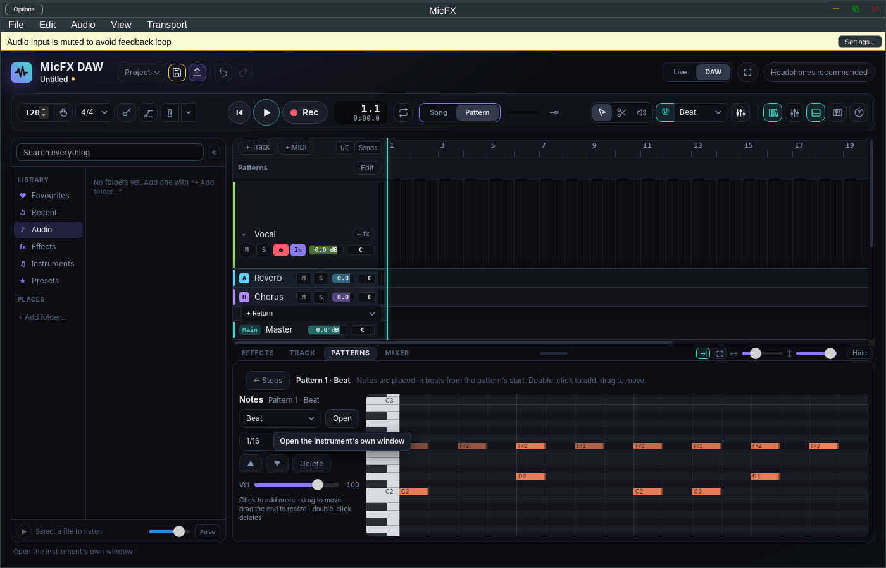

The **Patterns** tab in the bottom panel is a step sequencer in the style of a classic loop-based beat maker.

- A **rack of rows**: one row per drum sound for a drum kit track (Beat or Kit), one row per track for other MIDI tracks. Each row has mute, level, a name, and 16 step buttons (16th notes). Left-click lights a step, right-click clears it.
- A **pattern** is the content of all rows for one loop. You can have many. Set its length, step size (1/8, 1/16, 1/32, triplet) and **swing**.
- Empty project: **Start with a drum kit** adds a Beat track and a 16-step pattern.
- **Pattern blocks** sit in the **Patterns lane** under the ruler. A block longer than the pattern repeats it. All blocks of one pattern share the same content. *Make unique* gives one block its own copy.
- The **Pattern / Song** switch next to the loop button plays either only the selected pattern or the whole arrangement.
- **Record** in Pattern mode loops the pattern and adds what you play on the selected row's track (or armed MIDI tracks), snapped to the grid, pass after pass. One undo step per recording.
- **Velocity bars** under a row set the strength of each step: click or drag to set or ramp.
- **Notes** opens the piano roll on a part for notes that do not fit the grid.
- **Turn into MIDI clips** writes a block out as ordinary MIDI clips. **Make a pattern from this clip** goes the other way.
- Drag an audio file from the library onto the Patterns tab to put it on a Kit pad.

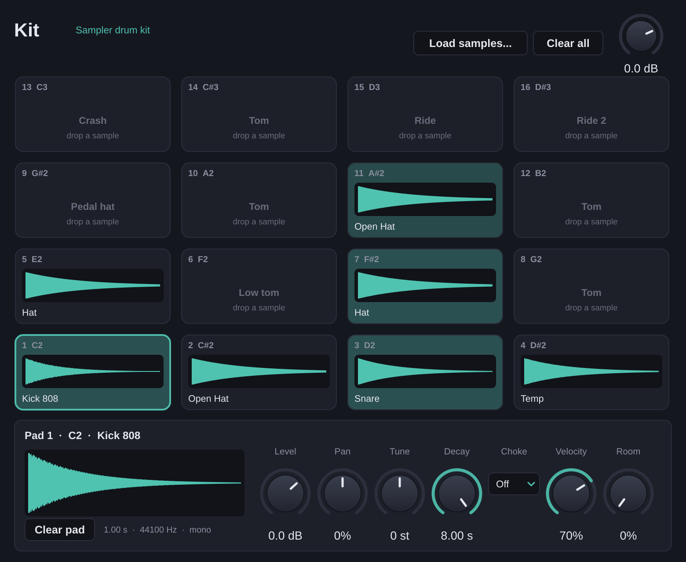

## 4.11 Auto Mix

Every smart tool is also in the **Assist** menu on the toolbar, grouped by what it works on: the song (Auto Mix, Mix Check, Master the song, Song key, Song map), the selected track (Fit into the backing, Clean and polish, Pick the best takes, Align to…) and the selected clip (Split into stems, Rebalance, Find song sections, Convert to MIDI, Build backing vocals). An entry that needs a selection is greyed out and says what to select.

**Auto Mix…** at the top of the DAW screen (or **Edit → Auto Mix…**) mixes your voice against the backing track, locally, using the effects you already have.

1. Pick a **style**: Pop, Ballad, Rock, or Voice up front (the voice further up front so you can hear yourself).
2. Press **Listen**. It renders every track offline and measures loudness (EBU R128), tone, when each track plays, your lowest notes and where the backing covers your words.
3. It guesses which track is the **voice** and which is the **backing**. Change a role and the plan updates.
4. It shows every change with the reason, for example "Cut 3.5 dB at 315 Hz: muddy":
   - **Voice**: a Parametric EQ (low cut, mud and harshness cuts or a presence lift, boom and air shelves), a **Smooth** resonance suppressor where it rings, a Compressor if your level swings (with the **Punch** character for Pop, Hip-hop, Rock and Electronic, and an **Opto** after it for Ballad, R&B, Acoustic and Jazz), a **Smart** De-esser if the S's stand out. On a dry voice the space is a **Plate** with its pre-delay set from the song's tempo and ducking while you sing, and an echo that follows the tempo and ducks too. Background vocals also get a micro-shift **Doubler**.
   - **Backing**: a small EQ dip where it covers your voice.
   - **Balance**: your volume so the voice sits the style's amount over the backing.
   - **Pan**: tracks are placed left and right (centre for voice, bass, kick and snare, pairs of the same kind spread apart) while staying mono-safe.
   - **Phase**: microphones that recorded the same sound are lined up (time offset and polarity) when that lowers cancellation. Switch it off with *Line up mics (phase)*. The track menu also has *Align to…*, *Invert polarity* and *Reset alignment*.
   - **Master**: towards −14 LUFS without clipping.
5. **Apply** writes it all as one undo step. **Hear before / Hear after** switches while the song plays. **Amount** makes it gentler. Everything it changed is an ordinary insert or fader you can adjust.

**Match a reference…** picks a song you like and matches the master to it: a gentle master EQ towards its tonal balance and a master volume towards its loudness.

## 4.12 Mix Check

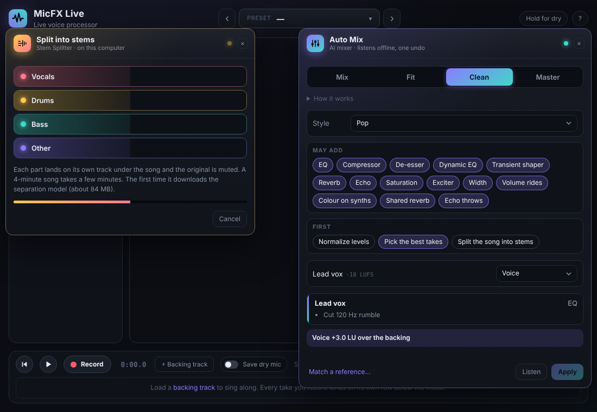

**Mix Check** in the toolbar listens to the whole mix and writes a **report**. Each finding says what is wrong and offers a **Fix** button. It checks loudness, true peak, squashed dynamics, tonal balance, whether the low end is mono, mono fold-down loss, phase, DC offset, masking between tracks, clipping, hum, sibilance, the lead's level, silence at the start and end, and tracks that are never heard. You can copy or save the report as text. Loudness and true peak share one fix (the mastering chain, or the limiter's drive).

The thresholds are a first guess for each style. Treat a finding as a second opinion, not a rule.

## 4.13 Song map

**Song map** (toolbar button, or the clip menu's **Find song sections…**) finds the beats, bars, tempo and sections (intro, verse, chorus…) of a song and marks the sections on the ruler as coloured ranges. Right-click a section to **Loop this section**. **Follow the performance** can make the project's tempo map follow a recording played without a click.

## 4.14 Convert to MIDI

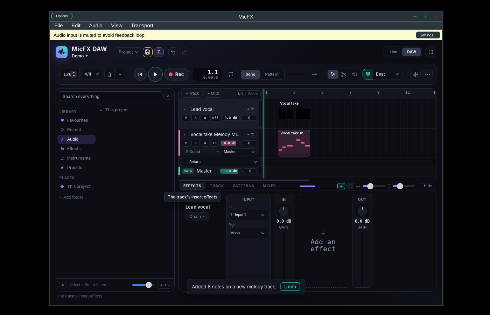

In the clip menu choose **Convert to MIDI**, then:

- **Melody…** turns a sung or played line into notes on a new piano track.
- **Bass line…** turns a bass line into notes on a new synth bass track.
- **Drums…** turns a drum loop into General MIDI drum notes on a new Beat track.

The options panel lets you set the quantize amount and more. On a full song the drums are easiest to hear on their own: split into stems first and convert the Drums track.

## 4.15 Split into stems

Select a song's clip and press **Split into stems**. MicFX separates it into **Vocals**, **Drums**, **Bass** and **Other**, each on its own track under the song, lined up with the clip, and mutes the original. One undo takes it back.

- It runs on your computer with **Demucs v4** (by Meta AI Research). Nothing is uploaded.
- The first split downloads the model once (about 84 MB) to `~/Library/Application Support/MicFX/Models/` and checks it.
- The song is cut into 30-second chunks that up to four CPU cores separate at once. The panel shows the time left. **Cancel** any time.
- The stems are 24-bit 44.1 kHz WAVs in the project's `Audio` folder.
- **Quality**: *4 stems* is standard. *6 stems* also pulls **Guitar** and **Piano** out of Other. *Best quality* runs four fine-tuned models, is about four times slower and the cleanest. The 6-stem and Best quality models run on the CPU only.
- On a Mac, the first 4-stem split also fetches the Core ML version of the model and tries to use the GPU. The panel says "on the GPU". If the check finds the GPU result differs from the CPU, it uses the CPU and says so.

**Rebalance stems** (clip menu) turns the vocals, drums, bass and the rest of one clip up or down without making tracks: a slider per stem (−30 dB is off, +12 dB boost, double-click for 0). **Reset** or undo brings the original back.

## 4.16 Backing vocals

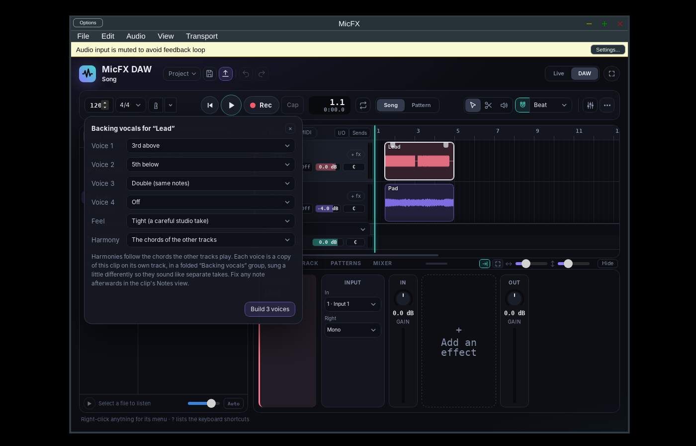

From the clip menu choose **Vocals → Build backing vocals…** on a lead vocal clip. Choose parts (third, fifth or sixth above or below, octaves, chord notes, or a **double track**) and MicFX writes each voice as a copy of the lead, with small timing nudges, detune and formant changes so they sound like different singers. The voices land on tracks in a folded **Backing vocals** group, panned in pairs, in one undo step. The key comes from the project key, or MicFX guesses it from your lead. Chord-based parts follow the song's chords.

## 4.17 Song key

**Key** next to the time signature (or **Edit → Song key…**) finds the key of the song.

1. Press **Detect**. It listens to every track except voices (your melody may be the thing that is off key) and compares the notes with how major and minor keys use their notes.
2. It shows the key, how clear the match is, the notes the music uses, and what each track alone suggests. A 432 Hz recording still lands on the right key and the panel says how far off it is.
3. The key is saved with the project. Pick another by hand if you disagree.
4. **Set autotune to key** points every Autotune in the session at it in one undo step. A new Autotune insert starts in the song's key.

## 4.18 Tempo and time

The clock shows the position. Click it to type a bar or time to go to. **T** taps the tempo. The project has a tempo map you can edit in the tempo lane. **Quantize** (Q) moves clips or sung hits to the grid, using the Pitch & time settings.

## 4.19 Keyboard shortcuts

Space, R, Home and M mean the same in both modes. Where the big DAWs agree (Space, S, Ctrl+Z, Ctrl+D…) MicFX uses the same key. On a Mac, read Ctrl as Cmd. Press **?** for the full list. The most useful:

| Keys | Action |
| --- | --- |
| Space | Play / pause (always, whatever has focus) |
| Keypad 0 | Stop and go to start |
| R or keypad * | Record on armed tracks |
| Shift+R | Punch on / off |
| L or keypad / | Loop range on / off |
| C | Click (metronome) on / off |
| F | Follow the playhead on / off |
| ← / → | Move the playhead a beat (Shift: a bar) |
| Home / End | Start / end of the song |
| Ctrl+T, Ctrl+Shift+T | New audio / MIDI track |
| M or 0 | Mute the selected track |
| S | Solo the selected track |
| Ctrl+K | Computer keyboard piano on / off |
| A | Arm the selected track |
| I | Monitor the mic on the selected track |
| Q or Ctrl+U | Quantize |
| V (1), 2, B, G | Select, range, cut and gain tools |
| Ctrl+1 / 2 / 3 / 4 | Finer grid / coarser grid / triplets / snap on-off |
| W | Edit the selected clip's pitch and timing |
| Ctrl+E | Split at the playhead |
| Ctrl+D | Duplicate |
| Ctrl+X, C, V | Cut, copy, paste |
| Delete | Delete the clip |
| Ctrl+Z, Ctrl+Shift+Z | Undo, redo |
| Ctrl+N, O, S, I | New, open, save, import |
| Ctrl+Shift+R | Export |
| Ctrl+B | Bounce the selected track to a new track |
| Shift+1 … 9 | Go to marker 1 to 9 |
| Ctrl+, | Settings |
| Tab or X | Tracks / mixer |
| E | Show / hide the effects panel |
| Shift+B | Show / hide the library |
| Ctrl+F | Search the library |
| Z, Shift+Z | Zoom to the clip / the whole song |
| F11 | Full screen |
| ? | The full list |
| F1 | This manual |

# 5. Tips and troubleshooting

- **Feedback or a howl**: use headphones, and make sure **Mute audio input** was unticked only once headphones were on.
- **No sound**: check **File → Audio settings…** for the right input and output.
- **Delay you can hear**: lower the buffer size. Denoise, Autotune and Smooth add a little latency each, only while they are on.
- **Takes slightly late or early**: check the interface's latency in the audio settings. Takes are shifted by the round-trip latency MicFX measures.
- **A plug-in is missing after you move computers**: install it again and press **Rescan plug-ins**.
- **Stem split falls back to the CPU**: this is normal on non-Mac machines, and on a Mac if the GPU check does not match. The result is the same, just slower.
- **Moved a Kit sample file**: the project looks for it by name next to where it was. If it is not found, drop it on the pad again.
- **Your data**: everything stays on your computer. Recordings are in `~/Music/MicFX Recordings`, projects in their `.micfx` folders, stem models and caches in `~/Library/Application Support/MicFX`.

# 6. Licence and credits

MicFX is released under the **GNU AGPL v3**. It is built on **JUCE**, whose free licence is also AGPLv3. A closed-source build needs a commercial JUCE licence.

Stem splitting uses **demucs.cpp** (MIT), **Eigen** (MPL 2.0) and the Demucs v4 weights (MIT, downloaded on first use). All are compatible with the AGPL.
